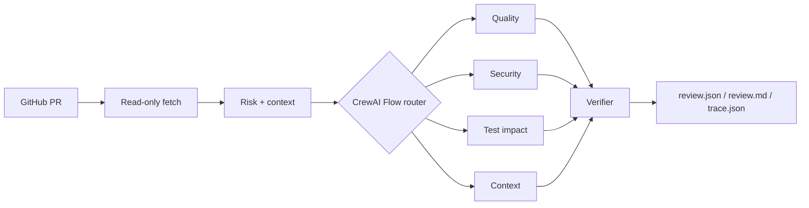

# PRGuard - Multi-Agent Intelligent Code Review System

PRGuard is a reproducible GitHub pull request review system built with CrewAI Flows and small specialist Crews. It fetches a PR read-only, classifies risk with deterministic rules, retrieves relevant Python context, runs only the necessary agents, verifies findings against source evidence, and writes JSON, Markdown, and execution trace reports.

The project began from the CrewAI GitHub pull request review template already present in this repository. The original package remains under `src/code_review_crew_for_github_pull_request/`; PRGuard is the independently implemented package under `src/prguard/`. See [architecture-baseline](docs/architecture-baseline.md) and [contributions](docs/contributions.md) for provenance and the exact change boundary.

## Architecture



Dynamic routing is deterministic: documentation-only changes run quality checks; executable changes add test-impact analysis; high-risk or large changes add security and context agents. Single and static strategies are available for evaluation. Specialist agents run concurrently under a semaphore, with a timeout, one bounded retry, independent error records, and no code execution or delegation.

## Install

Python 3.10-3.13 and [uv](https://docs.astral.sh/uv/) are supported.

```bash
uv sync
cp .env.example .env
```

For online reviews, set `DEEPSEEK_API_KEY` and optionally `DEEPSEEK_API_BASE`, `DEEPSEEK_MODEL`, or `PRGUARD_MODEL`. Set `GITHUB_TOKEN_CODEREVIEW` for private repositories or higher GitHub API limits. The token is read only; PRGuard never posts comments or modifies repositories.

For local, concurrent demos, set `OTEL_SDK_DISABLED=true` to disable CrewAI's anonymous telemetry initialization. If CrewAI reports a SQLite permission error for its task-output store, set `CREWAI_STORAGE_DIR=prguard` to use a separate local storage namespace.

The checked-in dependency lock keeps CrewAI at the existing `0.98.0`. No full framework upgrade is required for the Flow API used here.

## CLI

Review a PR by repository and number:

```bash
uv run prguard review --repo owner/repo --pr 123 --strategy dynamic --output-dir artifacts/review
```

Or use a canonical GitHub PR URL:

```bash
uv run prguard review --url https://github.com/owner/repo/pull/123 --strategy dynamic
```

The command accepts `--model`, `--concurrency`, `--timeout-seconds`, and `--max-agent-calls`. The CLI reviews a real GitHub PR; offline fixture evaluation is provided by the `evals.run` command below.

## Offline demo and evaluation

The checked-in dataset contains 15 manually reviewed Python fixtures covering null handling, missing exceptions, boundaries, resource leaks, SQL and shell injection, permissions, hard-coded secrets, test gaps, safe security patterns, documentation changes, and normal PRs.

Run all three strategies without an API key:

```bash
uv run python -m evals.run --mode offline --output artifacts/evals
```

Run one strategy:

```bash
uv run python -m evals.run --mode offline --strategy dynamic
```

The command writes timestamped `results.json`, `results.csv`, `benchmark.md`, and `benchmark.svg`. Offline scores describe the deterministic fixture runner plus routing, verification, and metric pipeline; they are not LLM quality claims. Online evaluation is available with the same fixtures once an API key is configured:

```bash
uv run python -m evals.run --mode online --strategy dynamic --model deepseek/deepseek-chat
```

See [evaluation](docs/evaluation.md) for the matching rule, [benchmark](docs/benchmark.md) for the measured records, [false-positive-analysis](docs/false-positive-analysis.md) for the audit of the first online run, and [experiments](docs/experiments.md) for the ablation design and cost estimate.

## Review quality controls

Prompt `prguard-review-v2` and the evidence-aware verifier replace "more findings" with "provable findings". The changes are reactive: each one addresses a cause identified in [docs/false-positive-analysis.md](docs/false-positive-analysis.md), which audits the 68 false positives of the first online run.

**Finding classification.** Every finding carries a closed-vocabulary `issue_type`, a `finding_type` of `defect` or `advisory`, and, for defects, a `trigger_condition`, `expected_behavior` and `actual_behavior`. A defect without a trigger condition is demoted to advisory by schema validation rather than accepted as a confirmed bug.

**Agent scope and abstention.** Each agent may only emit its own issue types, and returning an empty list is explicitly the preferred answer when nothing is provable. `TestImpactAgent` may report `missing_test_coverage` as a defect only when the changed code performs multi-resource mutations or side-effecting writes; otherwise a coverage gap is advice.

**Three-layer verification.**

| Layer | Check | Outcome |
| --- | --- | --- |
| 1 | schema, trusted path, line range, verbatim evidence, changed-file association, duplicate merge | reject fabricated locations |
| 2 | AST defect-condition check per `issue_type` (parameterized query, `shell=False`, closed handle, guarded divisor, `with open`, bound placeholder, mode bits, secret literal, off-by-one loop, Optional deref) | `condition_not_met` rejects; unresolved claims are demoted to advisory with `needs_human_review` |
| 3 | optional critic for low-evidence or conflicting findings | **not implemented**; requires a token budget and is deliberately absent from the reported results |

Layer 2 uses syntax trees, and only uses text matching to *refute* a claim. A file that merely mentions `sql_injection` is never treated as proof, which is covered by a test.

**Evaluation accounting.** Advisories no longer enter defect precision, but the evaluator also reports `strict_precision` where advisories count as false positives, plus `advisory_rate`, `verifier_rejection_rate`, per-agent rejection rates, and verifier before/after counts. Labelling everything as advice therefore cannot raise the headline number.

## Measured results

| Record | Scope | Result |
| --- | --- | --- |
| Offline, current branch | deterministic fixture runner, 15 fixtures, 3 strategies | dynamic P 1.000 / R 1.000 / F1 1.000, 2.73 calls per PR, 10/10 labelled defects |
| Online, `prguard-review-v1` | DeepSeek `deepseek-chat`, 15 fixtures, dynamic | P 0.093 / R 0.700 / F1 0.165, 7 TP / 68 FP / 3 FN, 3079 input tokens per PR, 10.96 s mean, 18.41 s P95 |
| Online, `prguard-review-v2` + evidence-aware verifier | same fixtures | **not measured yet**; no online budget has been approved for this branch |

The offline record is a pipeline regression test, not an LLM quality claim. The online v1 record is the baseline that the audit decomposes: of its 68 false positives, 44 (64.7%) were advice, style preferences or duplicates that the new classification keeps out of the defect count, 15 (22.1%) were real observations the fixtures do not label, and 9 (13.2%) were correct defects lost to the old language-and-line-sensitive matcher.


## API

Start the minimal FastAPI service:

```bash
uv run uvicorn prguard.api:app --reload
```

`POST /reviews` creates a background review, `GET /reviews/{run_id}` returns status and findings, `GET /reviews/{run_id}/result` returns the completed result, and `GET /reviews/{run_id}/metrics` returns execution metrics. Requests use the same Pydantic validation as the CLI.

## Web Dashboard

The Vue dashboard lives in `frontend/` and consumes the `/api/*` endpoints. It supports an explicitly labeled offline Demo Fixture mode, live GitHub reviews, SSE event replay, a Vue Flow execution graph, a Monaco Diff viewer, and the generated Benchmark artifacts.

Start the backend and frontend in separate terminals:

```bash
OTEL_SDK_DISABLED=true CREWAI_STORAGE_DIR=prguard uv run uvicorn prguard.api:app --reload
cd frontend && npm install && npm run dev
```

Open `http://127.0.0.1:5173/`. Demo cases use the manually reviewed local fixtures and deterministic runner; they are clearly marked in the UI and are not real LLM quality measurements. Live mode requires the configured `.env` keys. Dashboard events are kept in memory, so a backend restart loses active runs and their SSE history.

Frontend checks:

```bash
cd frontend
npm test
npm run build
```

## Tests

Tests never call a real LLM or write to GitHub:

```bash
uv run pytest -q
```

They cover input validation, GitHub error handling, deterministic routing, context and verifier boundaries, offline agent failure behavior, metrics, and API basics.

## Reports and safety

Each run receives a UUID and writes `review.json`, `review.md`, and `trace.json`. Reports include the head SHA, selected agents, findings, token usage, latency, errors, and prompt version. Trace files omit complete private repository contents and credentials. PR text, comments, README files, and code are treated as untrusted input; agent prompts ignore embedded instructions and no agent may execute repository code or shell commands.

Further details are in [architecture](docs/architecture.md) and [technical decisions](docs/technical-decisions.md).
