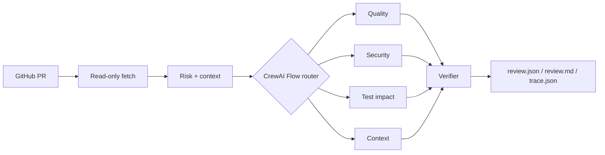

# PRGuard - Multi-Agent Intelligent Code Review System

PRGuard is a reproducible GitHub pull request review system built with CrewAI Flows and small specialist Crews. It fetches a PR read-only, classifies risk with deterministic rules, retrieves relevant Python context, runs only the necessary agents, verifies findings against source evidence, and writes JSON, Markdown, and execution trace reports.

The project began from the CrewAI GitHub pull request review template already present in this repository. The original package remains under `src/code_review_crew_for_github_pull_request/`; PRGuard is the independently implemented package under `src/prguard/`. See [architecture-baseline](docs/architecture-baseline.md) and [contributions](docs/contributions.md) for provenance and the exact change boundary.

## Architecture



Dynamic routing is deterministic: documentation-only changes run quality checks; executable changes add test-impact analysis; high-risk or large changes add security and context agents. Single and static strategies are available for evaluation. Specialist agents run concurrently under a semaphore, with a timeout, one bounded retry, independent error records, and no code execution or delegation.

## Install

Python 3.10-3.13 and [uv](https://docs.astral.sh/uv/) are supported.

```bash
uv sync
cp .env.example .env
```

For online reviews, set `DEEPSEEK_API_KEY` and optionally `DEEPSEEK_API_BASE`, `DEEPSEEK_MODEL`, or `PRGUARD_MODEL`. Set `GITHUB_TOKEN_CODEREVIEW` for private repositories or higher GitHub API limits. The token is read only; PRGuard never posts comments or modifies repositories.

For local, concurrent demos, set `OTEL_SDK_DISABLED=true` to disable CrewAI's anonymous telemetry initialization. If CrewAI reports a SQLite permission error for its task-output store, set `CREWAI_STORAGE_DIR=prguard` to use a separate local storage namespace.

The checked-in dependency lock keeps CrewAI at the existing `0.98.0`. No full framework upgrade is required for the Flow API used here.

## CLI

Review a PR by repository and number:

```bash
uv run prguard review --repo owner/repo --pr 123 --strategy dynamic --output-dir artifacts/review
```

Or use a canonical GitHub PR URL:

```bash
uv run prguard review --url https://github.com/owner/repo/pull/123 --strategy dynamic
```

The command accepts `--model`, `--concurrency`, `--timeout-seconds`, and `--max-agent-calls`. The CLI reviews a real GitHub PR; offline fixture evaluation is provided by the `evals.run` command below.

## Offline demo and evaluation

The checked-in dataset contains 15 manually reviewed Python fixtures covering null handling, missing exceptions, boundaries, resource leaks, SQL and shell injection, permissions, hard-coded secrets, test gaps, safe security patterns, documentation changes, and normal PRs.

Run all three strategies without an API key:

```bash
uv run python -m evals.run --mode offline --output artifacts/evals
```

Run one strategy:

```bash
uv run python -m evals.run --mode offline --strategy dynamic
```

The command writes timestamped `results.json`, `results.csv`, `benchmark.md`, and `benchmark.svg`. Offline scores describe the deterministic fixture runner plus routing, verification, and metric pipeline; they are not LLM quality claims. Online evaluation is available with the same fixtures once an API key is configured:

```bash
uv run python -m evals.run --mode online --strategy dynamic --model deepseek/deepseek-chat
```

See [evaluation](docs/evaluation.md) for the matching rule, [benchmark](docs/benchmark.md) for the measured records, [false-positive-analysis](docs/false-positive-analysis.md) for the audit of the first online run, and [experiments](docs/experiments.md) for the A/B/C design, [ablation-results](docs/ablation-results.md) for the measured re-scoring, and the `--dry-run` flag for a no-cost plan check.

## Review quality controls

Prompt `prguard-review-v2` and the evidence-aware verifier replace "more findings" with "provable findings". The changes are reactive: each one addresses a cause identified in [docs/false-positive-analysis.md](docs/false-positive-analysis.md), which audits the 68 false positives of the first online run.

**Finding classification.** Every finding carries a closed-vocabulary `issue_type`, a `finding_type` of `defect` or `advisory`, and, for defects, a `trigger_condition`, `expected_behavior` and `actual_behavior`. A defect without a trigger condition is demoted to advisory by schema validation rather than accepted as a confirmed bug.

**Agent scope and abstention.** Each agent may only emit its own issue types, and returning an empty list is explicitly the preferred answer when nothing is provable. `TestImpactAgent` may report `missing_test_coverage` as a defect only when the changed code performs multi-resource mutations or side-effecting writes; otherwise a coverage gap is advice.

**Three-layer verification.**

| Layer | Check | Outcome |
| --- | --- | --- |
| 1 | schema, trusted path, line range, verbatim evidence, changed-file association, duplicate merge | reject fabricated locations |
| 2 | AST defect-condition check per `issue_type` (parameterized query, `shell=False`, closed handle, guarded divisor, `with open`, bound placeholder, mode bits, secret literal, off-by-one loop, Optional deref) | `condition_not_met` rejects; unresolved claims are demoted to advisory with `needs_human_review` |
| 3 | optional critic for low-evidence or conflicting findings | **not implemented**; requires a token budget and is deliberately absent from the reported results |

Layer 2 uses syntax trees, and only uses text matching to *refute* a claim. A file that merely mentions `sql_injection` is never treated as proof, which is covered by a test.

**Evaluation accounting.** Advisories no longer enter defect precision, but the evaluator also reports `strict_precision` where advisories count as false positives, plus `advisory_rate`, `verifier_rejection_rate`, per-agent rejection rates, and verifier before/after counts. Labelling everything as advice therefore cannot raise the headline number.

## Path recovery and dedup

The first online run produced 28 findings and only 7 carried a usable `file_path`: the
model wrote `unknown` (13), an empty string (3), a bare basename (4) or a non-existent
file (1). Layer 1 therefore rejected 21 findings that were otherwise well formed.

`prguard.paths.PathResolver` recovers a path only from data the pipeline already trusts:
the PR's changed files, their sources, the cited line and the verbatim evidence. Statuses
are `exact`, `normalized`, `evidence_resolved`, `ambiguous`, `unresolved`; the original
value is kept in `reported_path` and the basis in `path_basis`, so a report never hides a
correction. Two guards matter: a bare basename must be unique in the diff, and evidence
must be unique to one changed file *and* within two lines of the cited line. A finding
whose evidence appears in two files is `ambiguous`, never "first match".

Deduplication now ranks signals by what they prove rather than by text similarity, which
does not work on Chinese: identical file, line within two, one specific `issue_type`, and
byte-identical evidence is the same citation. Two different `issue_type` values are never
merged, so two real defects in one function stay separate.

Replaying the frozen online findings (`evals.path_ablation`, no model call):

| Config | P | R | F1 | TP | FP | FN |
| --- | ---: | ---: | ---: | ---: | ---: | ---: |
| A layer 1 only | 0.667 | 0.400 | 0.500 | 4 | 2 | 6 |
| B + path recovery | 0.333 | 0.800 | 0.471 | 8 | 16 | 2 |
| C + dedup | 0.615 | 0.800 | 0.696 | 8 | 5 | 2 |
| D + layer 2 | 0.800 | 0.800 | 0.800 | 8 | 2 | 2 |

Path recovery buys recall and costs precision; dedup and layer 2 recover the precision.
Full analysis: [path-and-dedup-analysis](docs/path-and-dedup-analysis.md).

## Verifier ablation harness

`evals/ablation.py` compares verifier configurations without paying for a second model
pass: one run, frozen raw findings, then both rungs applied to that same list.

```bash
# plan and cost, no tokens
PYTHONPATH=src .venv/bin/python -m evals.ablation --mode online --dry-run

# one pass, both rungs, one report with raw + verified findings per case
PYTHONPATH=src .venv/bin/python -m evals.ablation --mode online \
  --model deepseek/deepseek-chat --output artifacts/evals/ablation
```

`--mode offline` exercises the harness with the deterministic runner; it validates the
plumbing only and says nothing about prompt quality.

## Measured results

| Record | Scope | Result |
| --- | --- | --- |
| Offline, current branch | deterministic fixture runner, 15 fixtures, 3 strategies, evaluator `prguard-eval-v2` | dynamic P 1.000 / R 0.900 / F1 0.947, strict F1 0.900, 9/10 defects, 1 advisory, 2.73 calls per PR |
| Online `prguard-review-v1`, legacy matcher | DeepSeek `deepseek-chat`, 15 fixtures, dynamic | P 0.093 / R 0.700 / F1 0.165, 7 TP / 68 FP / 3 FN |
| Same recording, unified matcher | re-scored, no model called | P 0.013 / R 0.100 / F1 0.024, 1 TP / 74 FP / 9 FN |
| Online `prguard-review-v2`, before verification | DeepSeek `deepseek-chat`, 15 fixtures, one pass | P 0.160 / R 0.400 / F1 0.229, 4 TP / 21 FP / 6 FN, 28 findings |
| Online `prguard-review-v2`, layer 1 (rung B) | same frozen findings | P 0.667 / R 0.400 / F1 0.500, 4 TP / 2 FP / 6 FN, 21 rejected |
| Online `prguard-review-v2`, layer 1 + 2 (rung C) | same frozen findings | identical to B: layer 2 rejected nothing on this run |

Read the ablation document before quoting any of these:
[docs/ablation-results.md](docs/ablation-results.md).

Three things to keep straight:

* The offline row is a pipeline regression test, not an LLM quality claim.
* The gap between the two online rows is a **measurement change**, not a model
  improvement. Prompt v1 emitted no classification and left 34 of 75 findings without
  a line number, so the unified rule cannot credit them. Reproducing the legacy row
  exactly is the point of freezing that scorer.
* Offline recall dropped from 1.000 to 0.900 on purpose: `missing_test_coverage` is
  now `UNKNOWN` unless the retrieved context contains the test file, because a diff
  cannot prove that no test exists. The finding is still reported, as an advisory
  needing human review.
* The online precision gain comes from one mechanism: the model wrote `unknown`, an
  empty string or a bare basename as `file_path` in 21 of 28 findings, and layer 1
  rejected them. It did not remove any claim about the wrong code. Recall is 0.400
  because five of the six missed defects were discarded for that same reason.
* Layer 2 measured zero effect: it confirmed six claims (`uncertain` to `verified`) and
  rejected none, so B and C score identically. Do not describe layer 2 as reducing
  false positives.

The audit that produced the 44 / 15 / 9 split, and the full per-finding classification, is in [docs/false-positive-analysis.md](docs/false-positive-analysis.md).


## API

Start the minimal FastAPI service:

```bash
uv run uvicorn prguard.api:app --reload
```

`POST /reviews` creates a background review, `GET /reviews/{run_id}` returns status and findings, `GET /reviews/{run_id}/result` returns the completed result, and `GET /reviews/{run_id}/metrics` returns execution metrics. Requests use the same Pydantic validation as the CLI.

## Web Dashboard

The Vue dashboard lives in `frontend/` and consumes the `/api/*` endpoints. It supports an explicitly labeled offline Demo Fixture mode, live GitHub reviews, SSE event replay, a Vue Flow execution graph, a Monaco Diff viewer, and the generated Benchmark artifacts.

Start the backend and frontend in separate terminals:

```bash
OTEL_SDK_DISABLED=true CREWAI_STORAGE_DIR=prguard uv run uvicorn prguard.api:app --reload
cd frontend && npm install && npm run dev
```

Open `http://127.0.0.1:5173/`. Demo cases use the manually reviewed local fixtures and deterministic runner; they are clearly marked in the UI and are not real LLM quality measurements. Live mode requires the configured `.env` keys. Dashboard events are kept in memory, so a backend restart loses active runs and their SSE history.

Frontend checks:

```bash
cd frontend
npm test
npm run build
```

## Tests

Tests never call a real LLM or write to GitHub:

```bash
uv run pytest -q
```

They cover input validation, GitHub error handling, deterministic routing, context and verifier boundaries, offline agent failure behavior, metrics, and API basics.

## Reports and safety

Each run receives a UUID and writes `review.json`, `review.md`, and `trace.json`. Reports include the head SHA, selected agents, findings, token usage, latency, errors, and prompt version. Trace files omit complete private repository contents and credentials. PR text, comments, README files, and code are treated as untrusted input; agent prompts ignore embedded instructions and no agent may execute repository code or shell commands.

Further details are in [architecture](docs/architecture.md) and [technical decisions](docs/technical-decisions.md).
