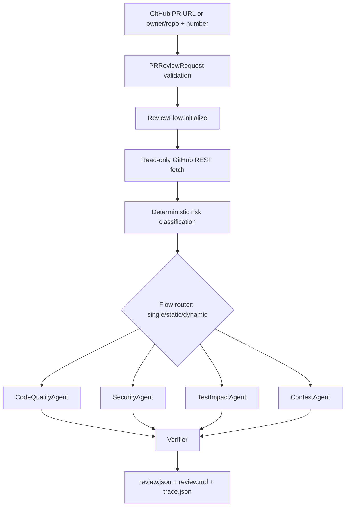

# PRGuard Architecture

`FlowState` carries the run ID, PR identity, head SHA, changed files, diff, risk level, selected agents, raw and verified findings, token counters, execution time, errors, agent runs, and trace events. A dynamic review starts with code quality, adds test impact for executable changes, and adds security/context agents for high or large risk. Documentation-only changes skip the specialist agents that cannot produce useful evidence.

Each specialist is a small Crew containing one role and one structured task. Tasks run concurrently under a semaphore, each has a timeout and one bounded retry, and a failed task becomes a partial result rather than aborting unrelated agents. Agent prompts explicitly treat PR content as untrusted data and disable code execution and delegation.

The verifier checks that a finding points at a changed or retrieved file, that cited lines exist in the head source, that the evidence appears near the cited lines, and that duplicate findings are merged. It rejects unsupported findings before reports are written.
